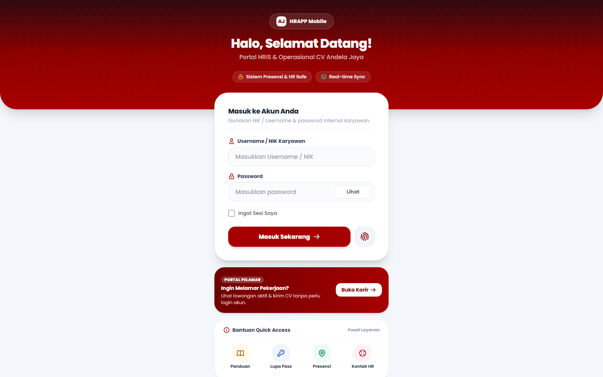
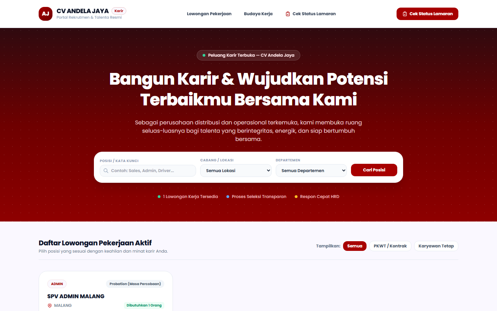

# 📘 PANDUAN PENGGUNAAN SISTEM AJ-HRIS
### Portal HRIS & Operasional CV Andela Jaya

> Versi panduan: Oktober 2026 · Berlaku untuk sistem AJ-HRIS (web) + HRAPP Mobile
> Panduan ini disusun sesuai kondisi sistem saat ini — label menu persis seperti tampil di layar.

---

## DAFTAR ISI

1. [Memulai: Masuk ke Sistem](#1-memulai--masuk-ke-sistem)
2. [Konsep Dasar yang Wajib Dipahami](#2-konsep-dasar-yang-wajib-dipahami)
3. [Role & Hak Akses](#3-role--hak-akses)
4. [Alur Koordinasi & Persetujuan (Flow Sistem)](#4-alur-koordinasi--persetujuan-flow-sistem)
5. [Panduan Per Menu](#5-panduan-per-menu)
   - 5.1 Beranda & Umum (Dashboard, Pengajuan, Riwayat, Persetujuan, Kalender, Memo)
   - 5.2 Kehadiran (Absensi, Cuti, Izin)
   - 5.3 Kepegawaian (Karyawan, Dokumen, Kontrak, Kinerja)
   - 5.4 Rekrutmen (ATS & Portal Karir)
   - 5.5 Pelatihan
   - 5.6 Disiplin (Konseling, SP)
   - 5.7 Keuangan & Fasilitas (Reimbursement, Kasbon, Klaim Bensin, Lembur, Uang Makan, Inventaris, Kendaraan, SOP)
   - 5.8 Sales (Order, Outlet, Item, Kunjungan, Tracking)
   - 5.9 Administrasi Sistem (Data Master, Hak Akses, Konfigurasi, Form Builder, Export Data)
6. [Alur Khusus: Mesin Fingerprint](#6-alur-khusus-mesin-fingerprint-alat-absensi)
7. [FAQ & Troubleshooting](#7-faq--troubleshooting)

---

## 1. MEMULAI — MASUK KE SISTEM

### 1.1 Halaman Login

Buka alamat AJ-HRIS (portal web perusahaan). Halaman pembuka seperti di bawah ini:



| Elemen | Fungsi |
|---|---|
| **Username / NIK Karyawan** | Isi NIK atau username internal yang diberikan HRD |
| **Password** | Password dibuat oleh HRD saat pembuatan akun; klik **Lihat** untk memunculkannya sementara |
| **Ingat Sesi Saya** | Centang agar tidak perlu login ulang di device yang sama sangat lama |
| **Masuk Sekarang →** | Tombol masuk |
| Tombol sidik jari 🔒 | Info fitur login biometrik **HRAPP Mobile** (aplikasi HP), bukan untuk web |
| **Buka Karir →** | Masuk ke **Portal Pelamar** (tanpa perlu akun karyawan) |
| Bantuan Quick Access | Panduan, Lupa Pass, Presensi, Kontak HR |

> 💡 **Lupa password?** hubungi HRD lewat ikon **Kontak HR** atau minta reset dari menu Hak Akses di HRD.

### 1.2 Portal Karir (untuk pelamar — TANPA login)

Halaman `Portal Karir` dibuka oleh masyarakat umum/pelamar:



- **Lowongan Pekerjaan** — daftar lowongan aktif; bisa difilter (Posisi/kata kunci, Cabang/Lokasi, Departemen) dan disaring PKWT/Kontrak vs Karyawan Tetap.
- **Budaya Kerja** — profil perusahaan.
- **Cek Status Lamaran** — pelamar menyemaskan status lamarannya sendiri.
- Tombol **Cari Posisi** menjalankan filter.
- Melamar → kandidat upload CV (PDF/DOCX) → CV **langsung diproses mesin ATS** otomatis (lihat §5.4).

### 1.3 Kerangka Setelah Login

Setelah masuk, kihikiri tampil **sidebar berisi menu** (isinya bergantung role — lihat §3), kanan tampil konten. Di kanan atas ada lonceng 🔔 (**notifikasi internal**) dan avatar profil.

---

## 2. KONSEP DASAR YANG WAJIB DIPAHAMI

### 2.1 Tiga jenis "pemberitahuan" dari sistem

| Jenis | Bentuk | Catatan |
|---|---|---|
| Lonceng 🔔 in-app | Daftar notifikasi di dalam web | Percetakan utama |
| Push FCM | Notifikasi di HP (via HRAPP Mobile infrastruktur) | Otomatis |
| Email | Dikirim ke email karyawan/approver | Penerima ditentukan Form Builder + role (§4.3) |

### 2.2 Status pengajuan

```
DIBUAT (MENUNGGU) → tahap 1 → tahap 2 → ... → APPROVED FINAL
                                  └── REJECTED (bila ada satu saja menolak, berhenti)
```

- Setiap tahap punya satu **utusan pemroses** (siapa: lihat §4.1).
- Setiap keputusan **ambil catatan** wajib di isi ke kolom Catatan — catatan muncul di riwayat & email ke pemohon.
- Jika form diset **wajib LPJ** (Laporan Pertanggungjawaban), setelah APPROVED FINAL pemohon harus **isi LPJ** sebelum batas waktu (standar **7 hari**): lihat §5.1.c Riwayat.

### 2.3 Mode Lihat saja (Read-Only)

GM **tidak pernah** mengubah data: rule sistem = GM membuka SEMUA menu, tetapi tombol simpan/edit/hapus tidak tersedia (badge "Hanya Lihat (Read-Only)"). Hal serupa bisa diberikan ke siapapun oleh HRD via *Hak Akses* — tanda `read_only` (§5.9.b).

### 2.4 Cakupan Cabang (Branch Scope)

Sejak hadirnya role **BRANCH MANAGER** (Kepala Cabang), kebanyakan modul operasional **berisi data cabang peka**: akun Kepala Cabang hanya melihat/memproses data **cabangnya sendiri** (misal Malang), sedangkan role pusat (HRD, SUPERADMIN, GM, DIREKTUR, FINANCE) melihat semua cabang.
Menu yang menerapkan pembatasan ini: **Absensi, Cuti, Izin, Lembur, Kasbon, Reimbursement, Klaim Bensin, Pemanggilan/SP, Konseling, Training, Sales Tracking, dsb.**

---

## 3. ROLE & HAK AKSES

### 3.1 Daftar role yang ada di sistem

| Role | Siapa | Ringkasan hak |
|---|---|---|
| **SUPERADMIN** | Pemilik sistem | Semua menu + semua aksi (`*`) |
| **HRD** | Staf HR | Paling lengkap: kelola karyawan, absensi, cuti, approval, ATS, kontrak, training, SP, dokumen, pengaturan |
| **GM / DIREKTUR** | General Manager / Direksi | **Membuka semua menu TAPI hanya melihat**; dapat memantau, menyetujui di kasus tertentu (approval.view/approve), branch scope tidak berlaku |
| **FINANCE / ACCOUNTING/KEUANGAN** | Keuangan | Approval reimbursement/kasbon + **Tandai Cair (mark_paid)**, **Kasbon: Lunas/Potong Gaji**, approve budget training, rekap uang makan |
| **BRANCH MANAGER** (alias: BRANCH_MANAGER, BRANCHMANAGER, KEPALA CABANG, KACAB) | Kepala Cabang | Menu operasional lengkap **hanya cabang sendiri**; ikut approval; PETUNJUK: data diatur HRD dengan mengisi `role=BRANCH MANAGER` + `cabang` di datab.karyawan |
| **MANAGER / KOORDINATOR** (preset = SPV) | Manajer cabang/kantor | Approval atasan, kunjungan sales, konseling, lembur, penilaian bawahan |
| **SPV / SUPERVISOR** | Supervisor | Approval stage SPV, izin, interview scoring, penilaian harian, lembur |
| **ATASAN** *(dinamis)* | Siapa pun yang tercatat sebagai kolom "atasan" di master karyawan | Otomatis dapat menu **Persetujuan** tanpa perlu dirilis manual |
| **WAREHOUSE / GUDANG** | Gudang | + Inventaris (serah-terima), kendaraan BBM |
| **BACK OFFICE (BO)** | Back office | + Lembur (dashboard & usulan), LPJ, penilaian kontrak sendiri |
| **SALES** | Salesperson | Menu sales penuh, pengajuan umum; **TIDAK diizinkan lembur** |
| **STAFF/KARYAWAN/DRIVER** (default) | Semua karyawan | Dashboard, Pengajuan, Riwayat, Absensi Saya, Pengajuan Cuti, Izin, Review Kinerja Saya, Profil, Klaim Bensin, dsb |

> ⚠️ **Sistem mengenali alias agar penulisan role di data tidak kaku** oleh stanza: misal `HR`, `ADMIN`, `ADMINISTRATOR`, `KEUANGAN`, `GUDANG`, semua varian BRANCH MANAGER).

### 3.2 Hak akkses **per user** (bisa lebih ketat dari role)

HRD bisa **mengatur khusus satu orang** (Whitelist) melewati preset role:

- **allowed_menus** — menu mana saja yang terlihat
- **allowed_submenus** & **allowed_actions** — submenu dan tombol/aksi granular per modul
- **allowed_forms** — form mana saja yang muncul di Katalog Pengajuan
- **read_only** — paksa mode lihat saja
- Ketiganya diprioritaskan di atas preset role (badge profil berubah jadi "Whitelist Kustom Super Admin")

---

## 4. ALUR KOORDINASI & PERSETUJUAN (FLOW SISTEM)

### 4.1 Siapa memproses tahap apa

Ketika pengajuan dibuat, sistem menaruh **daftar tahap** sesuai "Alur Persetujuan" yang dipilih saat form dibuat di Form Builder. Pemroses tiap tahap alias labelnya:

| Label Tahap | Siapa yang boleh menyetujui |
|---|---|
| **ATASAN** | Atasan langsung pemohon (tercatat di master karyawan); SUPERADMIN; siapa pun ber-role ATASAN |
| **SPV / SUPERVISOR** | Role SPV/SUPERVISOR, atau jabatan mengandung SPV |
| **MANAGER / MANAJER / BRANCH MANAGER** | Manajer / Kepala Cabang — **saat ini pembatasan cabang**: hanya pemohon dari cabang sama |
| **HRD / HR** | Role HRD, ADMIN, ADMINISTRATOR, SUPERADMIN |
| **FINANCE / ACCOUNTING** | Role FINANCE/ACCOUNTING (+ dapat mengisi **Rekomendasi budget Finance (Rp)**) |
| **GM / GENERAL MANAGER** | Role GM / jabatan GM (read-only, tapi boleh approve stage ini) |
| Lainnya (TEKSTUR BEBAS) | Dicocokkan ke role/jabatan/nama yang sama di master karyawan |

> SUPERADMIN **selalu** bisa memproses tahap mana pun. Pemohon **tidak bisa menyetujui pengajuannya sendiri** (email/aksi atasannya yang dipilih).

### 4.2 Diagram alur umum

```
 KARYAWAN                    ATASAN/SPV/MGR/BM          HRD / FINANCE             GM
    │  isi form di                 │                        │                     │
    │  "Pengajuan" /               │                        │                     │
    │  "Pengajuan Cuti"/"Izin"     ▼                        ▼                     ▼
    │        ┌────────────  TAHAP 1  ──►  TAHAP 2  ──►   TAHAP 3  ──►  (TAHAP GM)
    │        │              Setujui/Tolak (dengan catatan; email ke tahap berikutnya)
    │        ▼
    │   email/push ke approver TAHAP 1 (info: "Persetujuan Dibutuhkan")
    │        ▼
    ├──── APPROVED FINAL ────► efek akhir:
    │        • Cuti     → membalik saldo jatah & membuat Form Cuti fisik (PDF)
    │        • Izin     → tercatat di data absensi (izin terlambat/pulang cepat/keluar)
    │        • Reimb/Kasbon → pencatatan utk FINANCE "Tandai Cair"/"Lunas"
    │        • Email hasil otomatis ke pemohon + penerima "hasil_status"
    │
    └──── REJECTED ────► email ke pemohon berisi catatan penolak; alur berhenti
```

### 4.3 Aturan email bulan Form Builder

Saat HRD membuat form di **Form Builder**, tiap orang yang dirugikan bg informasi diberi 3 tombol (bisa dipilih sekaligus jika perlu):

| Flag | Artinya | Kapan dikirim |
|---|---|---|
| **info_dinas** | Sekadar mengetahui ada pengajuan baru | Saat submit |
| **approval** | Diberi tahu karena ikut alur approval | Saat submit + tiap kali tahap naik |
| **hasil_status** | Mengenal hasil akhir | Saat APPROVED FINAL / REJECTED |

Sistem juga otomatis mengemail: **approver tahap aktif** ("Persetujuan Dibutuhkan…", dengan tombol `Tinjau & Otorisasi Pengajuan →`) dan **pemohon** ("Pengajuan Disetujui/Ditolak…").
Kadang email terlambat/gagal → approver/HRD bisa pakai tombol **Kirim Manual Notifikasi** di menu Persetujuan.

### 4.4 Membuat & menghapus pengajuan

- Pengajuan **tidak bisa diedit** setelah keputusan — untuk revisi data (klaim bensin), HRD pakai **"Simpan Revisi HRD"** di detail approval (Catatan revisi rekam).
- Data master pengajuan tersimpan permanen; HRD bisa mengunduh seluruh rekam jejak via **Data Master → Rekap Seluruh Pengajuan** dan **Export Data**.

---

## 5. PANDUAN PER MENU

> Sidebar tiap orang beda-beda. Bab ini menulis SEMUA menu yang ada; Langkah baca = sesuai submenu yang tampil.

### 5.1 BERANDA & UMUM

#### a) 🏠 Dashboard
- Sapaan otomatis (pagi/siang/sore/malam) + kartu profil (masa kerja, usia).
- **Widget** yang bisa ditampilkan/disembunyikan HRD global atau per orang (Konfigurasi): Saldo Cuti, Tugas KPI, Cuti Hari Ini, Pengumuman, Informasi Karyawan, Attendance, Performance, Assets, Kontrak, Sales Performance.
- **Pengumuman** bisa ditutup per-orang (dismiss); isinya kartu memo.
- **Tugas KPI** bersifat klik-dari-notifikasi: klik notifikasi → langsung terbuka form penilaian.

#### b) 📝 Pengajuan *(semua role)*
Kartu-kartu **Katalog Formulir** tampil sesuai hak (rs. `allowed_forms`). Cara pakai:
1. Pilih kartu formulir → modal terbuka.
2. Isi: kolom sesuai siapa yang membuat (teks/angka/tanggal/pilihan/upload/…) — kolom formula menghitung sendiri.
3. **Submit** → pengajuan tersimpan (id `TRX…`), status **MENUNGGU**, notifikasi & email ke approver tahap 1 + penerima info_dinas.
4. Formulir **cuti tidak ada di sini** — sistem otomatis mengarahkan ke menu **Pengajuan Cuti** (agar saldo & validasi masa kerja dipakai).

#### c) 🗂️ Riwayat *(semua role)*
- Daftar pengajuan milik sendiri (HRD melihat semua): status berwarna (Kuning=MENUNGGU, Hijau=APPROVED, Merah=DITOLAK).
- **Isi LPJ** untuk pengajuan yang wajib pertanggungjawaban (tampilkan deadline; lewat deadline = TINGGI RISIKO di catat).
- **Unduh PDF Surat Cuti / Form Klaim Bensin / cetak dokumen dinas** untuk yang APPROVED.

#### d) ✅ Persetujuan *(approver)*
- Tab **"Menunggu Persetujuan Saya"** — daftar tahap di mana kamu utusan.
- Tab **"Riwayat Proses Saya"** — keputusan yang pernah kamu buat.
- Klik baris → modal detail (lampiran, rincian, riwayat catatan).
- Tombol: **Setujui** / **Tolak** (*catatan wajib*), **Kirim Manual Notifikasi**; khusus Klaim Bensin: HRD boleh **Simpan Revisi HRD**; Finance bisa isi **Rekomendasi budget**.
- Aturan cabang: Kepala Cabang hanya melihat/memproses pengajuan pemohon cabangnya.

#### e) 📅 Kalender
- Kalender bulanan "Kalender Pintar HR", indikator bisa difilter: **Cuti / Izin, Ulang Tahun, Anniversary, Habis Kontrak, Agenda HR**.
- HRD: **Tambah Agenda Internal** (tambah/edit/hapus) + kirim email ucapan/reminder.
- GM: hanya melihat.

#### f) 📰 Memo & Berita
- Buat memo (editor rich, bisa menyisipkan **tabel memo**), simpan **Draft** → **Publish** (tersebar ke semuanya/terpilih) → kirim **email + push**.
- Lampiran diupload ke Drive (dhmi 3MB utk lampiran email; sisanya sebagai tautan Drive).
- Menghapus memo ikut menghapus notifikasinya.

### 5.2 KEHADIRAN

#### a) ⏰ Absensi
Modul terbesar untuk kehadiran. Sub-menu: **Dashboard Absensi** & **Proses & Tarif Laporan**.
- **Analitik & filter** (per tanggal/cabang/divisi), deteksi **"Absensi Hilang Hari Ini"**.
- **Koreksi** (edit log presensi) & **Hapus Bulk** — hanya yang punya hak `absensi.data.edit/delete` (diatur HRD di Hak Akses, bukan otomatis karena role).
- **Import Excel presensi** (termasuk file format fingerprint "1-Aug-26"), **Generate Report Excel** (19 format kolom Andela), **Arsip/Tarik Spreadsheet** via Apps Script (panel periode).
- **Integrasi mesin fingerprint**: lihat Bab 6.
- Penalti & tarif telat/alpa dihitung otomatis dari **Konfigurasi > Tarif**; baris dengan NIK `FINGER-` adalah baris mentah tunjukk-an pemetaan → tombol **Petakan** (HRD).

#### b) 👤 Absensi Saya *(karyawan)*
Riwayat presensi pribadi, perbandingan ke shift, badge status (Tepat waktu/Telat/Belum scan dsb).

#### c) 🌴 Pengajuan Cuti *(semua role)*
1. Kartu **saldo** muncul: Jatah / Terpakai / Sisa per kategori (Tahunan, Akumulasi, Khusus) + label masa kerja.
   - Aturan jatah: **bulan 1–3 belum mendapat cuti tahunan**; bulan ke-4 mulai **3 hari**; **+1 hari per bulan** berikutnya sampai 12 hari; **masa kerja ≥ 1 tahun langsung 12 hari**; karyawan tetap (PKWTT/KARTAP) langsung penuh setelah bulan ke-3.
2. Pilih **Jenis Cuti** (C, C½, C+, C+I, S, S-, CB, C-, A, CS, D, C-BESAR, dst.) — tiap jenis punya aturan kategori (Tahunan/Khusus/Tidak Dipotong/Potong Gaji), ada yang memicu dampak disiplin/review gaji.
3. Isi tanggal; sistem **menghitung hari kerja** dan melewati **libur nasional**; jenis tertentu **wajib lampiran** (Sakit → **Surat Keterangan Dokter/RS**; C½ menuntut konfirmasi payroll).
4. **Kirim** → alur approval (lihat §4).
5. Sistem **memotong jatah** otomatis saat APPROVED FINAL dan membuat **Form Cuti fisik (PDF)** ; salinan di **master_cuti**.

#### d) 📊 Kelola Cuti *(HRD / PIC cabang)*
Sub-tab:
- **Daftar Card Karyawan** — kelola saldo & riwayat per orang, filter cabang + periode (**Dasar Periode**: Tanggal Pelaksanaan Cuti / Waktu Input HRD).
- **Atur Jatah & Import Excel (SK 018)** — import jatah massal (SheetJS), **Reset Tahunan**, sinkron dokumen.
- **Atur Jenis Cuti** — master jenis + kategori potongan; jenis C-1/2 wajib persetujuan payroll.
- **Export**: "Tarik Riwayat Cuti (Excel)" & "Tarik Jatah Cuti (Excel)".
- ACS/Cuti GLOBAL: HRD pusat bisa **melihat semua cuti lintas cabang**.

#### e) 📃 Izin *(semua role)*
Jenis: **Izin Datang Terlambat**, **Izin Pulang Cepat**, **Izin Keluar Kantor / Dinas Luar**.
- Isi form → notifikasi ke atasan + **WA-flash alert cabang (sendBranchInstantAlert)** → approval.
- Sub-menu **Lihat Semua Izin** hanya untuk HRD/pusat (& Kepala Cabang = hanya cabangnya).
- Izin approved **otomatis masuk ke sistem absensi** (izin-attendance).

### 5.3 KEPEGAWAIAN

#### a) 👥 Karyawan (Siklus Karyawan) *(HRD)*
- Input **mutasi / promosi / demosi / onboarding / offboarding**; finalisasi otomatis **men-update master karyawan** (banyak fields sekaligus).
- Cetak dokumen **Exit Clearance & Handover Pekerjaan** (checklist aset/seragam/HRD).
- Riwayat pergerakan per karyawan tersimpan (`employee-history`).

#### b) 📄 Dokumen *(HRD)*
- Master **template dokumen** (PKWT, PKWTT, SP1, dsb.) dengan **placeholder dinamis** ({NAMA_KARYAWAN}, {JABATAN}, {GAJI_POKOK}, {ALASAN_SP}…).
- Alur: **Draft → isi klausul → Simpan & Rilis (publish) → kirim ke tanda tangan digital**; preview/unduh PDF/Word.

#### c) 📈 Review Kinerja
- HRD membuat **periode review**, **menerbitkan/publish hasil**, hapus.
- Karyawan: tab **Review Kinerja Saya** (+ cetak/unduh hasilnya); role manajemen: **Semua Review Kinerja**.

#### d) 📑 Penilaian Kontrak & KPI
Sub-menu: **Standar Grade HRD**, **Template Soal KPI**, **Distribusi Tugas KPI** (+ tab internal: kontrak/evaluasi/kpi360).
- **Distribusi KPI 360°** — HRD menetapkan penilai per karyawan; sistem mengirim notifikasi (+ pesan WhatsApp disiapkan via tombol); pengingat & penghapusan tugas.
- **Penilaian Harian** — Sales: Volume Dulux/Catylac/Maxilite/Aquashield, Value Tertagih, Overdue Piutang, Outlet Aktif; Non-Sales: SOP & Ketepatan Kerja, Respon & Pelayanan, Kedisiplinan, Teamwork; plus target bulanan.
- **KPI scoring otomatis** → grade & kesiapan keputusan kontrak (aturan grade di **Standar Grade**).
- **Kontrak** — tambah/perpanjang kontrak, evaluasi koordinasi (menu "Koordinasi" mengumpulkan review atasan terlebih dahulu), **Terbitkan dokumen kontrak baru (execute_renewal)**; penuh: HRD/SUPERADMIN/DIREKTUR; MANAGER/SPV/Kepala Cabang hanya bawahan cabang-nya.
- Export rekap Excel; cetak dokumen penilaian; integrasi penalti absensi.

### 5.4 REKRUTMEN (ATS & Portal)

Menu **Rekrutmen** dengan 8 sub-tab:
| Sub-tab | Isi |
|---|---|
| **Dashboard ATS** | Ringkasan funnel & metrik |
| **Lowongan** | Master lowongan (cabang, divisi, atasan, tipe), buat via wizard |
| **Kandidat** | Daftar kandidat (semua sumber: portal publik & input manual) |
| **Screening ATS** | Mesin penyaring CV: ekstraksi PDF/DOCX + bobot rule (Pendidikan 10, Pengalaman 25, SIM 15, Domisili 10, Keahlian 20, Software 10, Industri 10), **threshold lulus 70**, pengecualian alumni/kompetitor tertentu; tanpa AI eksternal (GRATIS/lokal) |
| **Pipeline** | Papan Kanban: *Pelamar Baru → Screening ATS → Shortlist HR → Interview → Offering/PKWT → Hired* |
| **Interview** | Scorecard interview (template sales/general) |
| **Analytics** | Funnel conversion, distribusi skor band (90-100 Highly Recommended … <60 Not Recommended), rejection factors |
| **Master Rules ATS** | Aturan sinonim/bobot/eksklusi/template |

- Portal publik **#karir** (lihat §1.2) mengirim CV masuk ke sini otomatis.
- Input pelamar manual juga bisa dari sini (modal intake).

### 5.5 PELATIHAN (Training & TNA)

Sub-tab: **Pelatihan Saya · Distribusi Survey TNA · Analisis Kebutuhan · Planning & Persetujuan · Pelaksanaan · Laporan Manajemen**.
Alur lengkap:
```
Campaign/TNA (HRD distribusi Survey TNA)
  → karyawan isi survey (assignment + pengingat)
  → Analisis Kebutuhan (gap = kebutuhan - kondisi)
  → Planning & Persetujuan:  HRD membuat program → mbutu persetujuan GM/Direktur + persetujuan ANGGARAN Finance
  → Pelaksanaan: kehadiran, biaya aktual, nilai dampak (30–60 hari)
  → Laporan Manajemen (export)
```
Karyawan melihat kelas/kuis/feedback di **Pelatihan Saya**; Budget/GM/BRANCH MANAGER melihat program cabangnya.

### 5.6 DISIPLIN

#### a) 💬 Konseling & Coaching
5 tab: **Dashboard Kasus, Manajemen Kasus, Action Plan, Jadwal Follow-up, Laporan & Rekap (PDF/Excel)**.
- Kategori kasus / sumber / root cause / tindakan / status **terstandardisasi** (pilihan terkontrol, tidak bebas menakar).
- Keputusan mengikuti **kebijakan perusahaan** (peraturan pasal/pelanggaran bawaan sistem — usulan SP menuntut dasar pasal atau SOP + bukti + klarifikasi).
- Deep-link dari Absensi/KPI → langsung membuka "kasus baru" dengan data terisi.

#### b) 🚨 Disiplin & SP *(HRD & Kepala Cabang, cabangnya)*
- Dua panel: **Surat Pemanggilan Klarifikasi (HR-PGL)** dan **Surat Peringatan (SP)** — CRUD + **cetak/PDF** berkop.
- Terkait konseling: SP hanya bisa diusulkan mengikuti aturan kebijakan.

### 5.7 KEUANGAN & FASILITAS

#### a) 💸 Reimbursement
1. **Pengajuan pribadi**: pilih **jenis klaim** (4 bawaan: *Bensin & Transportasi · Pengobatan & Rawat Jalan · Makan Client & Jamuan Bisnis · Kebutuhan ATK*) — masing-masing punya **plafon mingguan/bulanan/tahunan**; kelebihan plafon → sistem menolak.
2. Upload nota/bukti (ke Drive) → Submit.
3. **Daftar Pengajuan** (approver): Setujui/Tolak.
4. **Tandai Cair** (mark_paid / Ditransfer) khusus **FINANCE/SUPERADMIN**.
5. **Pengaturan Jenis & Plafon** untuk HRD.

#### b) 🏦 Kasbon
- Kategori bawaan: *SPP/Biaya Sekolah Anak · Keperluan Sekolah/Kerja · Pengobatan & Darurat · Renovasi/Musibah · Kebutuhan Mendesak Lainnya* — tiap kategori mewajibkan jenis/jumlah lampiran minimal tertentu.
- Alur approval → **Lunas / Potong Gaji** ditandai oleh FINANCE.
- Cetak bukti kasbon (PDF berkop).
- **Pengaturan Kategori** untuk admin.

#### c) ⛽ Klaim Bensin
- **Tab Form**: input **multi-baris perjalanan** (tanggal, KM awal/akhir, parkir, denda). Sistem menghitung: `((KM akhir - KM awal) / 25) × Rp10.000` (harga bensin × rasio 25 km/L) **+ parkir − denda** per baris, lalu **Grand Total**.
- **Tab Admin Cabang** (Cirebon & Malang) — khusus pejabat berhak: badge jumlah, pencarian, total nominal disetujui, **cetak Rekap & Verifikasi**.
- HRD dapat **memperbaiki rincian** dari modal Persetujuan (Simpan Revisi HRD).

#### d) 🕐 Lembur / SPPKL
> Sistem **tidak menghitung nominal upah**; yang dihitung & diverifikasi adalah **Jam Lembur Disetujui (maks 4 jam/hari)**.
Sub-tab: **Dashboard · Perintah Lembur (buat SPPKL) · Usulan Saya (ajukan mandiri) · Persetujuan Saya · Realisasi & Verifikasi (bandingkan ke SPPKL, deteksi selisih, maks 4 jam/hari) · Rekap Jam Lembur (export 19 Kolom Standar Andela Jaya) · Laporan · Pengaturan**.
- PDF SPPKL tersedia; **SALES tidak punya hak lembur** (ditolak sistem); BRANCH MANAGER penuh untuk cabangnya.

#### e) 🍚 Uang Makan *(HRD/FINANCE)*
- Catatan trip perjalanan **driver & helper** (tarif dari Konfigurasi `tarif.um_driver`/`um_helper`), filter cabang memakai master karyawan, rekap & **export Excel**.

#### f) 📦 Inventaris *(HRD/GA)*
- CRUD barang, **restock & daftar belanja** (export), **serah-terima/assign-return + berita acara**, **stock opname** (blanko & laporan), **QR code barang** (label dengan tautan langsung), rekap.

#### g) 🚗 Kendaraan *(HRD/GA)*
- Kartu kendaraan (spesifikasi/status) + panel **BBM · Service · Pajak/KIR**; export Excel/Word; **Surat Kuasa & Surat Aset** otomatis.

#### h) 🎯 SOP & Gimmick
- **Distribusi Gimmick**: master gimmick (principle ICI/DCOTA/PRIMA, jumlah, toko, tanggal distribusi).
- **Database SOP & Flowchart Generator**: membuat flowchart (Mermaid/Kroki/Draw.io) + unduh dokumen SOP.

### 5.8 SALES

| Menu | Fungsi |
|---|---|
| **Sales Order** | Buat SO dari outlet & item; statistik Value/Count/AOV; cetak faktur PDF |
| **Outlet** | Master outlet binaan; koordinat GPS otomatis (geocode + validasi); **Lihat Semua Outlet** & **Import Excel** utk HRD/lead |
| **Item** | Master item (SKU/kategori/harga/satuan) |
| **Kunjungan** | Agenda kunjungan ke outlet → selesaikan (tanggal selesai + catatan); status PENDING/COMPLETED |
| **Tracking** | Timeline kunjungan + **peta** (rute, jarak Haversine, odometer); sinkron **Kanal.work**; arsip spreadsheet; import/export Excel & PDF; **Konfigurasi Titik Keberangkatan** (HRD). GM melihat; standard karyawan hanya miliknya |

### 5.9 ADMINISTRASI SISTEM

#### a) 🗄️ Data Master *(HRD/SUPERADMIN)*
5 panel: **Karyawan** (master lengkap), **Rekap Seluruh Pengajuan** (export), **Dokumen Operasional**, **Tanda Tangan Digital**, **Raw DB** (lihat/hapus per koleksi — 🛑 destruktif, wajib konfirmasi). Ada tombol **sinkron nama karyawan ke seluruh modul**.

#### b) 🔐 Hak Akses *(HRD)* — menu "Pengaturan"
4 tab: **Users, Menu (RBAC), Forms, Kanal**.
- **Users**: daftar akun + **Undang Karyawan Baru (Buat Akun)**.
- **Menu (RBAC)**: centang per user → menu/submenu/aksi granular; **Preset Template** instan per role (incl. BRANCH MANAGER); toggle **read_only**; Simpan → profil user menampilkan "Whitelist Kustom".
  > 🛠️ Untuk Kepala Cabang Malang: pastikan akun memiliki `role = "BRANCH MANAGER"` dan `cabang = "Malang"` di master karyawan/user.
- **Forms**: batasi formulir yang boleh diakses per user.
- **Kanal**: konfigurasi API Kanal (uji koneksi, tarik data) — untuk sinkron tracking sales.

#### c) ⚙️ Konfigurasi *(HRD)*
Jadwal **shift master**; **Tarif** (um_driver, um_helper, lembur BO/Gudang, tol telat, denda/alpa); **Widget dashboard** (global & per-NIK); **Email reminder** (SMTP, pengingat otomatis, digest cuti pagi/sore per cabang, kirim test, jalankan scan sekarang); **Daftar cabang**.

#### d) 🧰 Form Builder *(HRD)*
- Buat form: **drag & drop** jenis kolom: Teks Singkat, Paragraf, Angka, Tanggal, Waktu/Jam, Tgl & Waktu, Skala Penilaian, Radio, Checkbox, Dropdown Manual, Daftar/List, Dropdown Database (master karyawan/kendaraan/inventaris), Formula Kalkulasi, Upload Foto/File; kolom bisa jadi **quiz** (kunci jawaban + score), bisa kondisional (`show_if`).
- **Alur Persetujuan**: pilih urutan chip role (HRD/GM/FINANCE/SPV/ATASAN/SALES/MANAGER/**BRANCH MANAGER**).
- **Akses form**: allowed_users (pilih personil) dan allowed_rules (role).
- **Notifikasi per personil**: 3 switch — **info_dinas / approval / hasil_status** (lihat §4.3).
- **LPJ**: aktifkan + batas hari + kolom LPJ.

#### e) ⬇️ Export Data / 👤 Profil Saya
- **Export Data**: CSV master karyawan lengkap (termasuk jatah cuti & finger name).
- **Profil Saya**: biodata + foto, badge Role & Hak Akses ("Preset Default Role" / "Whitelist Kustom", "Akses Penuh" / "Hanya Lihat"), arsip dokumen pribadi, tanda tangan digital.

---

## 6. ALUR KHUSUS — MESIN FINGERPRINT (ALAT ABSENSI)

```
 [Mesin Finger (X150/lainnya)]          [PC Cabang sebagai "Jembatan"]            [Server HRIS]
      scan jari  ────  kabel jaringan/USB  ──►  fingerprint-bridge (aplikasi kecil) ──► /api/sync-absen
```
Cara memasangkan (HRD):
1. Menu **Absensi** → panel buat kode: **"Tambah & Buat Kode Pairing"** → kode berlaku **30 menit**.
2. Di PC dekat mesin: jalankan script instalasi PowerShell `fingerprint-bridge/install.ps1 —HrisUrl <alamat-hris> —PairingCode <kode>`.
3. Jembatan mulai menerima scan dan **mengirim ke server** (dedup otomatis, scan ganda dihapus).
4. **Pemetaan Finger**: nama akun di mesin ↔ karyawan di master. Otomatis bila nama persis; kalau tidak:
   - pilih baris di analitik → tombol **Petakan** (per baris) atau **Petakan Finger Terpilih** (massal) → pilih karyawan + tanggal efektif.
   - baris **"Belum dipetakan"** menunggu dipetakan; **"Konflik pemetaan"** (ID pernah milik orang lain) memerlukan pemeriksaan HRD; aturan keamanan: **Emp No. ≠ No. ID** (dua ruang nomor berbeda), nama finger dianjurkan dijodohkan persis.
   - Menonaktifkan pemetaan **TIDAK menghapus riwayat lama**.
5. Hasil sinkron tampil di analitik absensi, penalti, laporan 19 kolom, dsb.

---

## 7. FAQ & TROUBLESHOOTING

| Pertanyaan | Jawaban |
|---|---|
| Menu saya tidak muncul | Menu bergantung role + whitelist. HRD dapat menambah via **Hak Akses > Menu (RBAC)**. |
| Tombol Setujui tidak terlihat padahal aku atasan | Pastikan kamu tercatat sebagai `atasan` karyawan tersebut, ATAU tahap di alur benar-benar sampai ke-mu. Cek Persetujuan > "Menunggu Persetujuan Saya" |
| Notifikasi tidak datang | Gunakan **Kirim Manual Notifikasi** di Persetujuan; pastikan email di profil benar & cek folder Spam. |
| Sisa saldo cuti saya salah | Saldo selalu **dihitung ulang** saat ditampilkan: (masa kerja sejak join) − (cuti disetujui). Import SK 018 menyesuaikan jatah; lapor HRD jika masih beda. |
| Scan mesin finger tidak muncul di absensi | Cek jembatan PC cabang nyala & kode pairing masih valid (30 menit); lihat baris "Belum dipetakan" lalu petakan. |
| GM ingin mengedit data? | GM **tidak** dapat mengedit — semua modul read-only. Edit oleh HRD/SUPERADMIN. |
| Saya Kepala Cabang, kenapa melihat cabang lain? | Pastikan `role = "BRANCH MANAGER"` + `cabang` terisi di akunmu (yang menyetel HRD). Role pusat (HRD/GM/dst.) memang melihat semua. |
| Sales butuh lembur | Role sales sistem tidak mengizinkan modul lembur dari aturan role; HRD dapat memberikan whitelist khusus jika memang sitomaspecial. |
| Upload CV gagal di Portal Karir | Gunakan PDF/DOCX maksimal ukuran umum, jangan file Foto/Koad scan; coba browser lain. |
| Lupa password | Hubungi HRD → reset di Hak Akses > Users. |

---

*Laporan isi ini disusun langsung dari kode sumber sistem (auth.js, router, dan seluruh js/views) supaya label dan hak istimewa SCADA persis dengan implementasi. Tangkapan layar halaman dalam akan ditambahkan bertahap (lihat catatan di bawah).*
